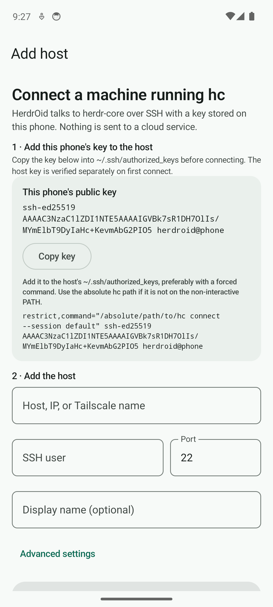
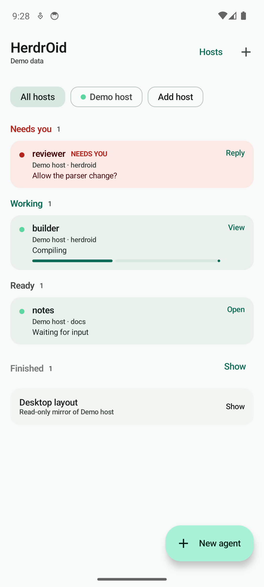
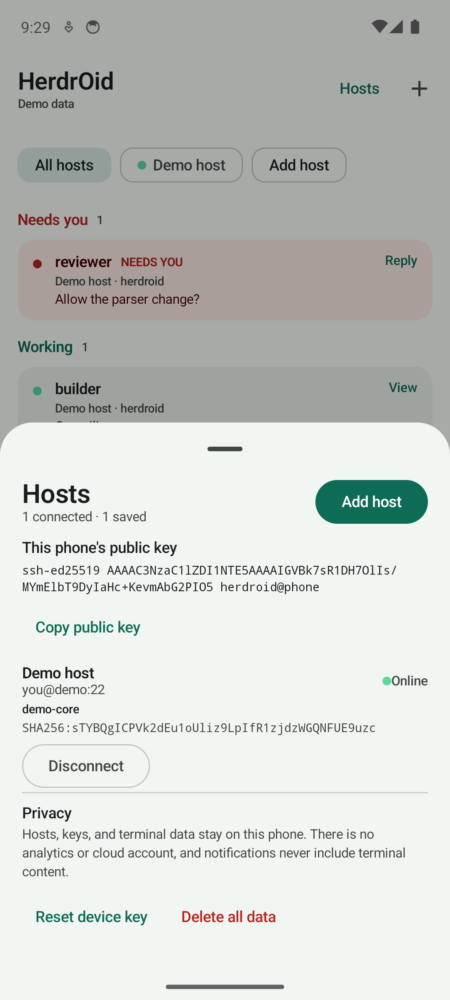
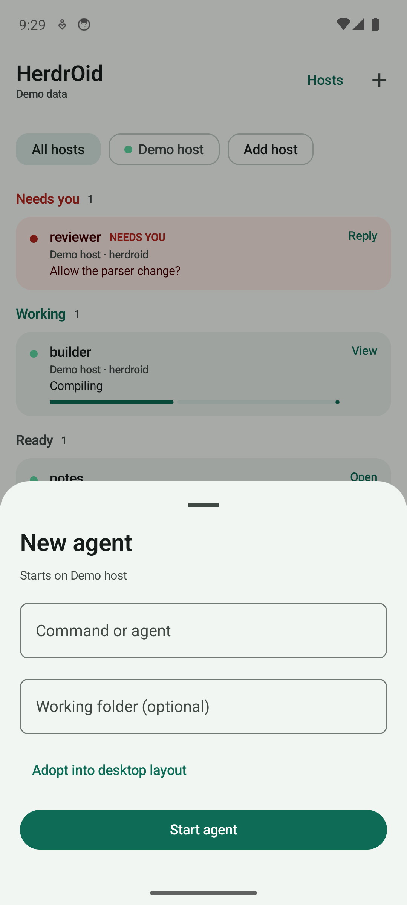
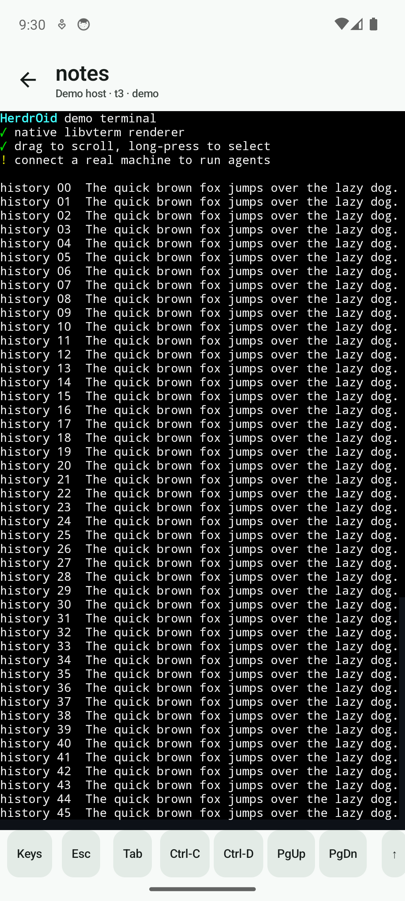

# HerdrOid

> **Heads up: no human has reviewed this code.** HerdrOid was written by AI
> models (LLMs). I use it on my own phone and test every change by hand before
> it ships, but I have not read the code and there are no plans for a human
> review soon. Several automated AI review passes, including security-focused
> ones, check each change for security, accessibility, memory use, and good
> practice in the design and logic; their fixes go in before release. That is
> still not a person reading the code. Keep that in mind before installing it,
> especially because it stores an SSH key and can run commands on a machine you
> authorize.
>
> **No data collection.** HerdrOid has no server, no analytics, no tracking, and
> no cloud account. It only connects to the SSH host you add. Hosts, keys, and
> terminal data stay on your phone and that host; nothing is sent to a third
> party.

HerdrOid is a native Android client for a machine you own that runs
`herdr-core` (`hc`). It gives you a phone-first inbox for the agents and shells
running on that machine, and opens their terminals over SSH.

No cloud account, no WebView, no analytics. Your hosts, keys, and terminal data
stay on the phone; the only network connection is SSH to your own machine.

> **HerdrOid is a client, not a hosted service.** You need a machine running
> `hc` and SSH access to it. Installing the APK is only half of the setup; the
> other half is authorizing the phone's key on that machine.

## What you need

- An Android phone running Android 8.0 (API 26) or newer.
- A Linux or macOS machine (or WSL) with `herdr-core` installed, where
  `hc connect` works. Native Windows OpenSSH also works if `hc` is on the
  non-interactive `PATH`; a custom Windows absolute `hc` path is not supported
  yet. HerdrOid is currently tested against `herdr-core` 0.1.16; newer versions
  may work but are not verified.
- SSH access to that machine from the phone. Tailscale is a good way to get a
  stable private address.
- The SSH server must allow key authentication. HerdrOid does not support
  passwords or keyboard-interactive login.

## Install the APK

1. Open the [latest release](https://github.com/riyhs/Herdr-Oid/releases/latest).
2. Download `HerdrOid-<version>.apk`.
3. Open the file. Android may ask you to allow installs from your browser or
   file manager. Allow it for this one install.
4. Launch HerdrOid.

The APK is signed by the project's release key. Release and debug builds use
different keys, so uninstall a debug build before installing a release APK.

## One-time host setup

1. Make sure `hc` works on the host:

   ```sh
   hc connect --session default
   ```

   Press Ctrl-C when you have confirmed it starts. The app uses the `default`
   session unless you choose another one.

2. On the phone, open **Add host**. The phone's public key appears near the top.
   Tap **Copy key**.

3. On the host, add the key to `~/.ssh/authorized_keys`. Prefer a forced
   command:

   ```text
   restrict,command="/absolute/path/to/hc connect --session default" <paste the key from the app>
   ```

   - Use the absolute path to `hc`. Non-interactive SSH sessions often do not
     include `~/.local/bin` in `PATH`.
   - `restrict` disables PTY, agent forwarding, port forwarding, and X11. The
     forced command still exposes the full `hc` API, so use a dedicated account
     or a container/VM if you need stronger isolation.
   - Keep the key on one line. `chmod 600 ~/.ssh/authorized_keys` and
     `chmod 700 ~/.ssh` are good defaults.

4. Back in HerdrOid, enter the host, IP, or Tailscale name, the SSH user, and
   the port (22 by default). A display name is optional.

5. Tap **Add and connect**. On the first connection, HerdrOid shows the host's
   SHA-256 fingerprint. Compare it with the fingerprint on the host before
   tapping **Trust and connect**.

   You can print the host fingerprint on the host with:

   ```sh
   ssh-keygen -lf /etc/ssh/ssh_host_ed25519_key.pub
   ```

   The path may differ on your system. Verify it through a channel you trust.

### If `hc` is not on the non-interactive SSH `PATH`

Use the absolute path in the forced command. If you do not use a forced command,
open **Advanced settings** in **Add host** and set **hc path** to the absolute
path, for example `/home/you/.local/bin/hc`.

### Named sessions

The normal `hc` session is `default`. If the host runs
`HC_SESSION=work`, use `--session work` in the forced command and set
**Advanced settings → hc session** to `work` in the app.

## Use it

1. **Inbox.** The home screen is the inbox: **Needs you**, **Working**,
   **Ready**, and **Finished**, across all connected hosts.
2. **Open a terminal.** Tap an agent row to attach. The Back arrow returns to
   the inbox.
3. **Start an agent.** Tap **New agent**, enter a command such as `claude` or a
   shell command, and optionally a working folder.
4. **Manage hosts.** Tap **Hosts** in the top bar to connect, disconnect, copy
   the phone's public key, reset trust, or remove a host.
5. **Notifications.** Allow notifications to get a private alert when an agent
   needs you. Terminal content is never included in the notification.

### Terminal gestures

- The keyboard is hidden when a terminal opens. Tap the terminal or the
  **Keys** button to show it.
- Drag vertically in a normal shell to scroll back through up to 1000 lines.
- Long-press to select and copy text.
- Full-screen TUI apps use the alternate screen and have no local scrollback.
  When the app enables mouse reporting, a vertical drag is sent as a mouse
  wheel event so the app scrolls in place. Otherwise use **PgUp**/**PgDn** or
  the app's own keys.

## Screenshots

| Page | Preview |
| --- | --- |
| **Add host** — copy the phone key and enter the SSH details |  |
| **Inbox** — needs you, working, ready, and finished agents |  |
| **Hosts** — saved hosts, public key, and privacy actions |  |
| **New agent** — start a command or agent on the connected host |  |
| **Terminal** — native terminal with key bar and scrollback |  |

The screenshots use the built-in demo data, not a real host.

## Privacy and security

- SSH is key-only. The phone's Ed25519 key is encrypted by an Android Keystore
  AES-256-GCM key. Decrypted key material is held in memory only and zeroed
  after use; there is no plaintext key cache file.
- Host configuration, including the pinned host key, is encrypted at rest. The
  legacy plaintext preference is migrated and removed.
- Host keys are pinned on first trust. If a host key changes, HerdrOid fails
  closed and requires an explicit trust reset.
- Cleartext traffic is disabled, Android backup and device transfer are
  disabled, and notifications are private.
- Remote terminal clipboard writes (OSC 52) are ignored. Copying a local
  selection marks it as sensitive. Hyperlinks only open `http` and `https`
  URLs.
- Overlay windows are hidden and obscured touches are rejected on the main
  activity.
- Release builds set `FLAG_SECURE` and disable the recents screenshot.
- HerdrOid never writes the desktop layout. It reads the `herdr-app` document
  and renders it read-only; there is no `doc.set` path.
- Release builds are minified and resource-shrunk with R8.

## Troubleshooting

**`Permission denied (publickey)`**
Check that the public key from the app is in the correct user's
`~/.ssh/authorized_keys`, on one line, and that the file permissions are
`600`. If you use a forced command, check the absolute path to `hc`.

**`hc: command not found`**
Non-interactive SSH often has a minimal `PATH`. Put the absolute `hc` path in
the forced command, or set **Advanced settings → hc path** in the app.

**The host key changed**
Do not reset trust until you have verified the new fingerprint on the host.
A changed host key can mean the machine was reinstalled, or that something is
intercepting the connection.

**The keyboard does not open**
That is intentional. Tap the terminal or the **Keys** button.

**A full-screen app does not scroll with a drag**
It is using the alternate screen. If the app enables mouse reporting, drag is
forwarded as a wheel event; otherwise use **PgUp**/**PgDn** or the app's own
keys.

**Android will not install the APK**
Allow installs from the browser or file manager you used. If you previously
installed a debug build, uninstall it first; the signing keys are different.

**Notifications do not arrive**
Android 13+ requires notification permission. Allow it in the app prompt or in
system settings. Battery optimization can also delay background alerts.

## Build from source

Requirements: JDK 17 and Android SDK Platform 37.0.

```sh
git clone https://github.com/riyhs/Herdr-Oid.git
cd Herdr-Oid
. scripts/env.sh          # Windows Git Bash; set ANDROID_HOME on Linux/macOS
./gradlew :app:assembleDebug
```

The debug APK is written to
`app/build/outputs/apk/debug/app-debug.apk`.

Useful checks:

```sh
./gradlew test
./gradlew :app:lintDebug
./scripts/check-invariants.sh
```

Android Studio is optional. The Gradle wrapper and Android SDK command-line
tools are enough.

## Releases and CI

Pushing a tag such as `v0.1` starts the release workflow. It runs the tests
and lint, builds a signed and minified APK, verifies the signature, and
publishes the APK plus a SHA-256 checksum on the GitHub Release.

The workflow requires four repository secrets for the release keystore:

- `HERDROID_KEYSTORE_BASE64`
- `HERDROID_KEYSTORE_PASSWORD`
- `HERDROID_KEY_ALIAS`
- `HERDROID_KEY_PASSWORD`

See [docs/RELEASING.md](docs/RELEASING.md) for the one-time keystore setup and
tagging steps. If the secrets are missing, the workflow fails instead of
publishing an unsigned APK. Normal pushes and pull requests run the CI workflow
without signing.

## Status and limitations

HerdrOid 0.1 is a development build. The protocol, SSH transport, encrypted data
layer, inbox, host management, and native terminal are implemented. The
transport has been verified on a physical Android phone against a live `hc`
host running `herdr-core` 0.1.16: connect, inbox, terminal attach, typing,
Back/reopen, timeout, and Cancel.

Known limitations:

- Full-screen TUIs without mouse reporting have no local scrollback; use
  **PgUp**/**PgDn**.
- Terminal rendering is CPU text shaping, not a GPU glyph atlas.
- Reconnect after phone sleep or network loss is still being hardened.
- There is no biometric app lock yet.
- Release signing is wired for CI, but the first signed release still needs the
  keystore secrets.
- Play Store and F-Droid packaging are not configured.

## Development

The code is split into `:core:domain`, `:core:data`, `:core:protocol`,
`:core:mirror`, `:core:ssh`, and `:app`. The UI never talks to SSH, the
protocol, or SharedPreferences directly.

See [AGENTS.md](AGENTS.md) for architecture, build, testing, and agent notes,
and [TODO.md](TODO.md) for the current backlog.

## Disclaimer

HerdrOid is not an official herdr.dev app. It is an independent, unofficial
client for `herdr-core`, and is not affiliated with, endorsed by, or supported
by herdr.dev or the herdr-core project.
